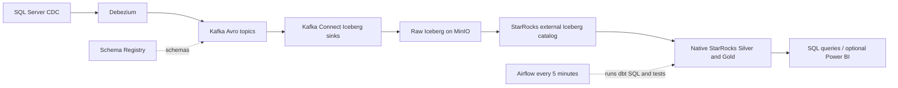

# SQL Server CDC Data Lake

A personal data engineering project that turns SQL Server changes into a queryable
operations report. The local demo uses synthetic seed data across 15 source tables
in `EKYC_ICICI` and `EKYC_ICICI_Archived`.

The working path covers CDC ingestion, append-only lake storage, current-state
SQL modeling, data quality, scheduling and failure diagnosis. The latest committed
verification built **8 Silver models + 1 Gold model and passed 32 dbt tests**.
See the [evidence index](evidence/README.md) for the actual runs and their limits.

## Architecture



Raw is Iceberg in MinIO, registered through an Iceberg REST catalog. dbt executes
SQL in StarRocks and materializes Silver/Gold as **native StarRocks tables**;
Gold is `default_catalog.analytics.gold_daily_operations_report`.
Airflow orchestrates transformations; it is not a separate data storage stage.

The [architecture guide](docs/architecture/01_end_to_end_flow.md) explains each
technology, inputs, consumers, proof and fallback. The original
[architecture image](Data_lake_poc_new_architecture.png) is preserved as a design
reference; the diagram above describes the implemented path.

## What is demonstrated

| Capability | Evidence |
| --- | --- |
| SQL Server CDC through Kafka into 15 Raw tables | [Baseline counts and connector states](evidence/README.md#1-working-baseline) |
| Keyed insert/update/delete interpretation, source ordering and replay fixtures | [CDC before/after checks](evidence/README.md#2-keyed-cdc-correctness) |
| One-command source-to-Gold lifecycle and cleanup | [CDC smoke check](evidence/README.md#3-end-to-end-smoke-check) |
| Lead grain, Gold population, agent relationships and required labels | [Quality checks](evidence/README.md#4-targeted-quality-checks) |
| Clear build/test failures and a genuine automatic scheduled run | [Airflow verification](evidence/README.md#5-airflow-failures-and-scheduled-success) |

Power BI connection instructions are available, but the current cleanup evidence
ends at queryable Gold. A public website/Pulse app and AI chat are deferred.
Prometheus/Grafana/Loki are historical proposals, not deployed by this Compose file.

## Run locally on Windows

Use Docker Desktop with Linux containers, Docker Compose v2, Git and PowerShell.
The recorded environment is a 16 GB Windows laptop; cold startup and image/plugin
downloads can take several minutes. Commands below run from the repository root.
The primary path runs dbt inside the existing Airflow container, so it does not
require a separate host Python installation.

```powershell
git clone https://github.com/Ajbil/Data-Lake.git
cd Data-Lake
powershell -NoProfile -ExecutionPolicy Bypass -File .\scripts\setup.ps1 help
```

**Already have a working installation?** Use [daily checks](#daily-checks) instead
of bootstrapping again. The sample bootstrap drops/recreates its report tables
and CDC instances; it is only for a new disposable local dataset.

### 1. Initialize a new local environment

```powershell
powershell -NoProfile -ExecutionPolicy Bypass -File .\scripts\setup.ps1 init
```

Review `.env` using [.env.example](.env.example). Keep `MSSQL_HOST=sqlserver` and
`MSSQL_PORT=1433` for connections inside Docker; host SQL clients use port `11433`.
Keep the report database names/topic prefix and local service names from the
example for this walkthrough. The sample SQL creates a fixed demonstration
Debezium login matching the example; changing environment values alone does not
change that SQL login. Keep real secrets in the ignored `.env`.

Install both connector plugins before the first Connect startup:

```powershell
powershell -NoProfile -ExecutionPolicy Bypass -File .\scripts\setup.ps1 plugin:avro
powershell -NoProfile -ExecutionPolicy Bypass -File .\scripts\setup.ps1 plugin:iceberg
powershell -NoProfile -ExecutionPolicy Bypass -File .\scripts\setup.ps1 start
```

The plugin scripts use a Maven Docker image; host Java/Maven is not required.
`start` brings up the default Compose services, including Airflow's image/init and
scheduler. Kafka UI and the Airflow webserver are optional and stay off by default.
If installing plugins into an already running Connect worker, restart only
`kafka-connect` after installation so it discovers the jars.

### 2. Create the synthetic source and register ingestion

Wait for SQL Server's ready-for-client-connections message before bootstrapping:

```powershell
docker logs --tail 30 mbs-sqlserver
powershell -NoProfile -ExecutionPolicy Bypass -File .\scripts\setup.ps1 bootstrap:report-sample
powershell -NoProfile -ExecutionPolicy Bypass -File .\scripts\setup.ps1 register:source
powershell -NoProfile -ExecutionPolicy Bypass -File .\scripts\setup.ps1 health:source
powershell -NoProfile -ExecutionPolicy Bypass -File .\scripts\setup.ps1 register:raw
powershell -NoProfile -ExecutionPolicy Bypass -File .\scripts\setup.ps1 health:iceberg
powershell -NoProfile -ExecutionPolicy Bypass -File .\scripts\setup.ps1 health:raw
```

Allow the initial snapshot and Iceberg commits to arrive. `health:iceberg` checks
both the source and all 15 sink tasks; a RUNNING connector wrapper alone is not
sufficient. `health:raw` lists catalog/storage objects rather than reconciling
all source rows. Stop and inspect a failed stage before continuing.

### 3. Build and test the report

```powershell
powershell -NoProfile -ExecutionPolicy Bypass -File .\scripts\setup.ps1 bootstrap:starrocks
powershell -NoProfile -ExecutionPolicy Bypass -File .\scripts\setup.ps1 health:starrocks
powershell -NoProfile -ExecutionPolicy Bypass -File .\scripts\setup.ps1 bootstrap:airflow
docker exec mbs-airflow-scheduler airflow dags pause mbs_daily_operations_report
```

Wait for DAG discovery. For a new installation the DAG starts paused. Before a
manual rebuild, confirm no running/queued work remains. If work is queued, allow
it to finish while unpaused before pausing again; paused DAGs do not drain queued
runs. Let any running task finish. Then run:

```powershell
docker exec -w /opt/airflow/dbt -e STARROCKS_DBT_HOST=starrocks-fe -e DBT_PROFILES_DIR=/opt/airflow/dbt mbs-airflow-scheduler /home/airflow/.local/bin/dbt build
powershell -NoProfile -ExecutionPolicy Bypass -File .\scripts\setup.ps1 health:dbt
powershell -NoProfile -ExecutionPolicy Bypass -File .\scripts\setup.ps1 health:airflow
```

Expect 9 models and 32 tests to pass. `health:dbt` displays counts; it is not a
substitute for the tests. `health:airflow` unpauses the DAG, triggers a
scheduler-managed **manual** verification and waits for its result. Subsequent
automatic runs use the five-minute schedule, with one active run at a time.

Steps 1-5 were verified on the existing local installation. This documentation
cleanup does not claim a fresh empty-volume installation test. Older installations
must follow the [catalog](docs/decisions/006_local_catalog_and_probe_memory.md) and
[Kafka storage](docs/decisions/007_kafka_log_storage.md) migration notes before
applying changed mounts; the startup guards protect that persisted state.

## Daily checks

On an initialized installation, `start` resumes services and `stop` retains their
volumes. Do not rerun sample bootstrap as a daily startup or recovery command.

```powershell
powershell -NoProfile -ExecutionPolicy Bypass -File .\scripts\setup.ps1 ps
powershell -NoProfile -ExecutionPolicy Bypass -File .\scripts\setup.ps1 health:iceberg
powershell -NoProfile -ExecutionPolicy Bypass -File .\scripts\setup.ps1 health:starrocks
```

To verify a complete synthetic insert/update/delete/rebuild lifecycle:

```powershell
powershell -NoProfile -ExecutionPolicy Bypass -File .\scripts\setup.ps1 test:cdc
```

It pauses scheduling, waits for active work (and rejects queued runs), uses a
unique synthetic lead, attempts cleanup and restores the original pause state.
Raw CDC history remains intentionally.
The recorded normal check took about 11 minutes 40 seconds, including waiting for
an active run; this is a regression check, not an ingestion latency benchmark.
See the [smoke runbook](docs/runbooks/02_poc_execution.md#one-command-cdc-smoke-check).
For failed jobs, use [Airflow failure inspection/recovery](docs/runbooks/03_airflow_failures.md).

## Query and demonstrate

Run this in a MySQL-compatible client connected to `localhost:9030`, database
`analytics`, with the local StarRocks credentials:

```sql
SELECT record_type, serviceable_pincode, COUNT(*) AS lead_count
FROM analytics.gold_daily_operations_report
GROUP BY record_type, serviceable_pincode
ORDER BY record_type, serviceable_pincode;
```

A [5-10 minute walkthrough](docs/runbooks/04_handover.md) connects the architecture,
CDC fix, quality failures and scheduled-run evidence to interview talking points.
[Power BI setup](docs/runbooks/03_powerbi_starrocks.md) is an optional manual step.

## Local endpoints

| Service | Host endpoint | Role |
| --- | --- | --- |
| SQL Server | `localhost:11433` | Source SQL; internal port `1433` |
| Kafka | `localhost:29092` | Host clients; containers use `kafka:9092` |
| Schema Registry | `http://localhost:8081` | Avro subjects |
| Kafka Connect | `http://localhost:8083` | Connector and task status |
| MinIO | `http://localhost:9000`, console `http://localhost:9001` | Object storage |
| Iceberg REST | `http://localhost:8181` | Raw table registrations |
| StarRocks | SQL `localhost:9030`, FE `http://localhost:8030`, BE `http://localhost:8040` | Raw queries and native report tables |
| Kafka UI (optional) | `http://localhost:8080` | Start with the dashboards profile |
| Airflow UI (optional) | `http://localhost:8088` | Start with the dashboards profile |

Compose also publishes Kafka `9092` and StarRocks RPC ports `9020`, `9050`, `9060`;
these are not the host SQL/Kafka client endpoints above. Airflow's metadata
PostgreSQL is internal. No ports change in this cleanup. To start optional UIs:

```powershell
docker compose --env-file .env -f infra/docker-compose/docker-compose.yml --profile dashboards up -d kafka-ui airflow-webserver
```

## Boundaries and remaining limitations

- Fourteen keyed physical sources use LSN-based current state with delete handling.
  The active assignment log lacks a stable key; its update/delete/replay behavior
  is outside that guarantee. See [schema contracts](docs/architecture/02_schema_contracts.md).
- Silver lead grain is `(source_table, customer_id)`. Cross-source business-lead
  deduplication is not implemented. Gold preserves eligible rows from those sources.
- Silver/Gold are full table rebuilds. Quality failure marks the job failed but
  does not roll back already rebuilt tables; readers can see transient rebuilds.
- The Gold date filter starts at month start two months before the current date,
  using created OR updated date. Recorded counts such as 11 Gold rows are dated
  observations, not permanent assertions; demo rows age out without new activity.
- Raw event counts, current entity counts and filtered report counts are different
  populations. The 32 tests are bounded checks, not complete source reconciliation.
- Five-minute scheduling is not a source-to-BI freshness guarantee. Recorded latency
  observations and forced rebuilds do not establish throughput, p95 latency or SLA.
- This is a single-node local POC with some floating image tags. A free public
  deployment, AI chat, HA/DR and a monitoring stack are not part of this delivery.

[Project risks](project_risks.md) and [lessons learned](lessons_learned.md) describe
these tradeoffs. [Historical milestones](docs/architecture/03_day_by_day_milestones.md),
[EC2 guidance](docs/runbooks/01_ec2_setup.md) and client-source notes preserve the
project's origin; Linux/EC2 deployment and Power BI UI refresh were not reverified
in the current six-step cleanup. The Linux runner has fewer commands; it does not
currently implement the Windows Airflow or CDC-smoke commands.
