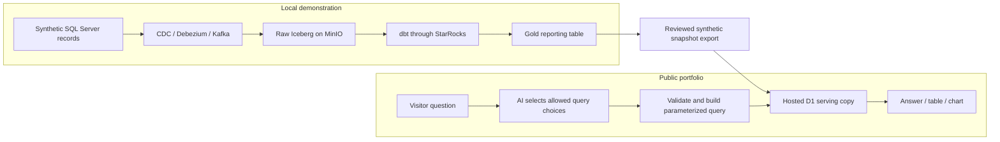

# Pulse Portfolio Research — 2026-10-30

Status: research and proposed direction; no app implementation or deployment.
Current priority (2026-10-31): complete the bounded six-step lake cleanup agreed
in chat. Pulse implementation and hosting remain deferred; this file is reference
research rather than an approved application build plan.
Official sources checked on 2026-10-30. Provider plans can change; verify account
eligibility and selected-model behavior before publishing.

## Confirmed Personal-Project Requirements

- Strictly ₹0 ongoing cost; limited usage and temporary unavailability are acceptable.
- Public website with a project/architecture overview and natural-language data questions.
- Answers, result tables and appropriate charts.
- Fully synthetic data only.
- A hosted sample of Gold data; the complete data lake runs separately for demonstrations.
- A fresh, smaller app using the previous MBS Pulse code as a reference.

## Legacy Pulse Code Review

Reference inspected read-only: `D:\Arihant Work\mbs-pulse-knacklabs\mbs-pulse`.
This was a source-code and documentation review. The old application was not
started, its dependencies were not installed, and its UAT claims were not retested.
No legacy `.env` contents or customer records were needed for this review.

### How the old question-to-answer path works

1. The Next.js/React frontend sends the question to `POST /api/chat` through its
   backend proxy. The original application requires a signed-in session.
2. NestJS resolves the user's allowed domains, metrics and groupings, plus a small
   amount of previous-question context.
3. The Bedrock provider sends that vocabulary to the model through Converse tool
   use. It accepts a structured metric/grouping/filter/date selection, a request
   for clarification, or an unsupported-question response. The model does not
   supply executable SQL or calculate the answer.
4. Application code validates the selection and builds SQL from defined metric
   expressions. The old path adds permission predicates where configured, records
   an audit event, checks the SQL and runs EXPLAIN before execution.
5. The warehouse adapter queries StarRocks, normally through MySQL port 9030.
6. The response includes actual result rows, metric definitions, the SQL, a
   plain-English interpretation and a data watermark. A deterministic chart
   chooser selects a KPI, line, bar, pie or table presentation; React/Recharts
   renders the returned results. Chart selection does not require another LLM call.

Source map within the reference repository:

| Evidence | Source |
| --- | --- |
| Frontend question request and proxy | `frontend/app/lib/api.ts:113`; `frontend/app/api/[...path]/route.ts` |
| Authenticated entry and orchestration | `backend/src/chat/chat.controller.ts`; `backend/src/chat/chat.service.ts:46` |
| Bedrock structured selection | `backend/src/llm/bedrock.provider.ts:320`; `backend/src/llm/llm.interface.ts` |
| Metric definitions | `backend/src/semantic/domains/operations.ts:24`; `backend/src/semantic/domains/leadActivity.ts:25` |
| Query construction/check/execution | `backend/src/sql/sqlBuilder.ts`; `backend/src/sql/sqlValidator.ts`; `backend/src/chat/selectionExecutor.ts:45` |
| Real StarRocks and offline modes | `backend/src/warehouse/starrocks-mysql.adapter.ts:80`; `backend/src/core/core.module.ts:35` |
| Answer, chart and provenance | `backend/src/chat/chat.service.ts:261`; `backend/src/chat/chartChooser.ts`; `frontend/app/components/AnswerCard.tsx`; `frontend/app/components/AnswerChart.tsx` |
| Prior demo claims and additional-table expectations | `README.md`; `docs/pipeline/gold-tables-requested.md` |

The app also implements users, roles, password reset, PostgreSQL-backed sessions
and audit, saved selections, pinned dashboards, curated reports and reconciliation.
These explain its size; they are not required for the chosen public portfolio MVP.
Package manifests confirm NestJS 10, Next.js 14, React, Drizzle, PostgreSQL,
mysql2, Bedrock SDK and Recharts dependencies. Their old version pins are reference
facts, not recommended dependency versions for the new application.

### Demo mode versus real data

The reference README records successful live-UAT use of Bedrock and StarRocks.
The checked-in Compose configuration, however, defaults to `LLM_PROVIDER=mock`
and leaves StarRocks unset. The mock LLM recognizes a limited keyword question;
the mock warehouse returns fixed example counts. Consequently, merely starting
that Compose project would not prove an AI question ran against this data lake.
The new public app must clearly distinguish AI interpretation, guided queries,
and fixed sample results; it must never silently substitute a mock success.

### Why changing the database endpoint is insufficient

Both repositories use the name `analytics.gold_daily_operations_report`, but
their expected column contracts differ. Inspection of the current
[`gold_daily_operations_report.sql`](../dbt/models/gold/gold_daily_operations_report.sql)
and searches across this project's models found:

| Old Pulse expectation | Current local Gold | Proposed MVP treatment |
| --- | --- | --- |
| `bank_name` | `bank_id`, without a readable bank-name field | Omit named-bank questions until a synthetic mapping is explicitly defined |
| `sr_status_name` | `sr_status`, without the expected readable status-name field | Omit named funnel stages and status-dependent metrics |
| `analytics.gold_lead_status_event` | No such dbt Gold model | Omit activity-history, hourly events and historical agent-performance claims |
| One current record per lead | Gold joins latest assignment/status/campaign records; uniqueness is not asserted by the existing Gold schema test | Check non-null, unique `order_number` before publishing a snapshot |
| Success/conversion definitions | The legacy app counts `record_type = 'RPush'` as success | Do not carry over that business assumption; expose Fresh/RPush labels only |
| Public-safe reporting columns | Current Gold includes `client_name`, `cust_landmark`, names and login fields | Publish a reviewed synthetic column allowlist, not a full-table dump |

The existing Gold is a native StarRocks table built by dbt from Iceberg Raw. It is
a current reporting snapshot, with a filter beginning at the start of the month
two months before the run. Lead creation trends can be grouped by creation date;
that does not establish historical status transitions or past daily snapshots.

Keep the design ideas of constrained selection, defined metrics, clarifications,
traceable results and deterministic charts. Write fresh code for the portfolio;
do not copy the old customer application, credentials, datasets or branding.

## Proposed Hosting Decision

Use one Cloudflare Workers Free project for static frontend assets and a small
question API, one D1 database for the synthetic Gold snapshot, and Workers AI
for interpreting questions. Use the provider's `workers.dev` address to avoid a
domain purchase. This is a proposed design, not a verified deployment. Cloudflare's
AI tutorial shows deployment to a `workers.dev` subdomain, and its product page
advertises free entry without a credit card.
[AI setup](https://developers.cloudflare.com/workers-ai/get-started/workers-wrangler/),
[Workers AI product](https://www.cloudflare.com/products/workers-ai/).

| Component | Why proposed | Receives from | Feeds/dependency | Acceptance proof | Fallback |
| --- | --- | --- | --- | --- | --- |
| Static frontend assets | Keeps the project overview and examples available independently of inference | Build output and synthetic example results | Visitors' browser | Open overview and examples while question API is disabled | Serve the same static build on another static host |
| Worker API | One small backend with direct AI and database bindings | Validated visitor question | AI interpretation, approved database query, answer response | Supported question produces expected result; invalid query plan is rejected | Keep static examples available with an explicit availability message |
| D1 | Small hosted SQL copy of the Gold contract without hosting the whole lake | Reviewed synthetic snapshot | Approved aggregate queries | Snapshot row counts and representative aggregates match source export | Publish fixed sample-result files until database availability returns |
| Workers AI | No separate paid LLM account needed for a free eligible model | Question plus allowed metrics, dimensions, filters and date context | Validated structured query selection | Evaluation questions choose expected metrics, filters and dates | Guided questions and clearly labeled precomputed examples |

These choices are engineering recommendations. The documented provider limits
below establish feasibility, not a guarantee of model accuracy or uptime.

## Verified Cloudflare Free Limits and Cost Boundaries

| Product | Current documented free allowance | Boundary |
| --- | --- | --- |
| Static assets | Free, unlimited asset requests; no additional asset-storage cost | Keep normal asset paths outside `run_worker_first`; API routes invoke Workers |
| Worker API | 100,000 requests/day; 10 ms CPU per invocation; 128 MB memory | Small validation and formatting work; avoid an entire Node backend or heavy local inference |
| D1 | 5 million rows read/day, 100,000 rows written/day, 5 GB total account storage | A free database is limited to 500 MB; reads measure scanned rows, so index the supported filters |
| Workers AI | 10,000 neurons/day across the free allocation | Free-plan operations fail after the allocation is exhausted; additional usage requires Workers Paid |

Sources: [static asset billing](https://developers.cloudflare.com/workers/static-assets/billing-and-limitations/),
[Worker limits](https://developers.cloudflare.com/workers/platform/limits/),
[D1 pricing](https://developers.cloudflare.com/d1/platform/pricing/),
[D1 limits](https://developers.cloudflare.com/d1/platform/limits/),
[Workers AI pricing](https://developers.cloudflare.com/workers-ai/platform/pricing/).

Remain on Workers Free. Do not activate Workers Paid, prepaid AI Gateway credits,
or paid-only models for this project. A free allocation on a **paid** account
does not impose the same ₹0 boundary: usage above the allocation can be billed.
Cloudflare identifies several newer Kimi, GLM-5 and DeepSeek-V4 models as requiring
a paid billing method. AI quota resets at 00:00 UTC (05:30 IST). This is an
account allowance, not a guaranteed number of visitors or questions.
[Workers AI pricing](https://developers.cloudflare.com/workers-ai/platform/pricing/).

D1 returns query errors when free daily read/write limits are exhausted. Storage
exhaustion requires cleanup before further storage changes. Its daily limits
reset at 00:00 UTC. The public UI must handle these failures without inventing
results. [D1 pricing](https://developers.cloudflare.com/d1/platform/pricing/).

Local Workers AI development still calls the Cloudflare account; it is not free
offline inference and consumes the account's allowance. Use saved structured
responses for routine local UI development and make live model checks deliberate.
[AI setup](https://developers.cloudflare.com/workers-ai/get-started/workers-wrangler/).

## Model Choice and Structured Query Selection

Workers AI JSON Mode supports a response schema, but the documentation explicitly
requires handling cases where the requested schema cannot be satisfied; JSON Mode
does not currently stream. Independently validate the returned selection before
executing anything. [JSON Mode](https://developers.cloudflare.com/workers-ai/features/json-mode/).

Evaluate `@cf/google/gemma-4-26b-a4b-it` first: Cloudflare explicitly lists it as
available on Workers Free; its model page documents function calling and
`response_format`. Disable thinking for this small classification task and cap
output. The model and API must still pass an account-specific structured-selection
trial; a supported response-format field alone does not prove accuracy for this
dataset. [Free-model announcement](https://developers.cloudflare.com/changelog/post/2026-07-28-models-require-workers-paid/),
[Gemma model](https://developers.cloudflare.com/workers-ai/models/gemma-4-26b-a4b-it/),
[tutorial](https://developers.cloudflare.com/workers-ai/get-started/workers-wrangler/).

`@cf/meta/llama-3.3-70b-instruct-fp8-fast` is another current model and is explicitly
listed by JSON Mode documentation. Evaluate it only if the first model's selection
quality is inadequate, and confirm free-account access at that point.
[Model](https://developers.cloudflare.com/workers-ai/models/llama-3.3-70b-instruct-fp8-fast/),
[JSON Mode](https://developers.cloudflare.com/workers-ai/features/json-mode/).

Same-day gotcha: the JSON Mode supported-model list still links
`llama-3.1-8b-instruct`, but opening that model returned the catalog with
`?unavailable=llama-3.1-8b-instruct`. Do not select a model solely from an older
example. This was a documentation/link observation, not a live inference test.
[Observed model URL](https://developers.cloudflare.com/workers-ai/models/llama-3.1-8b-instruct/).

Recommended application rule: the LLM selects an allowed metric, grouping,
filters, ordering and time window. Application code creates parameterized SQL
from that selection. Numbers and chart series come from query results; simple
summary text can be deterministic. Do not execute arbitrary LLM-generated SQL or
let the model claim values without querying the snapshot. This reduces model
calls and gives the portfolio a reproducible correctness story.

## Public Abuse and Availability

Proposed controls: short request bodies, bounded conversation context/output,
per-visitor request throttling, no automatic repeated model retries, a small
daily application question allowance, and a clear quota-exhausted state.

Cloudflare's native rate-limiting binding is approximate and local to each
Cloudflare location. It is useful for burst reduction; it is not a strict global
question or spending cap. Use an atomic D1 counter if a strict application-wide
daily question cap is needed. The provider's Free-plan boundary is the financial
backstop. [Rate-limiting binding](https://developers.cloudflare.com/workers/runtime-apis/bindings/rate-limit/).

Turnstile offers a Free plan with unlimited challenges. If enabled, validate
tokens server-side using Siteverify; the widget alone is insufficient. This is
an abuse-control option, not a substitute for API limits.
[Turnstile plans](https://developers.cloudflare.com/turnstile/plans/),
[server validation](https://developers.cloudflare.com/turnstile/get-started/server-side-validation/).

Serve the overview and a few labeled example results as static assets. On API or
AI failure, visitors can still explore the project. Do not label those examples
as live answers. Show dataset coverage and snapshot publication date, and anchor
relative-date questions to a disclosed demo date so the sample does not silently
become empty as calendar time advances. These are proposed product behaviors.

## Alternatives Considered

- **Same host with Gemini Free as the LLM:** credible fallback if Workers AI fails
  the question-selection evaluation. Google says new accounts begin on Free;
  paid tiers require linking billing and prepaying. Active limits are shown in
  AI Studio and vary by model/project. Exceeding a request/token limit causes an
  error. Free-tier content may be used to improve Google products, so retain the
  synthetic-only scope and do not submit personal content. A second provider adds
  account/key management; it is not needed initially.
  [Gemini billing](https://ai.google.dev/gemini-api/docs/billing),
  [Gemini limits](https://ai.google.dev/gemini-api/docs/rate-limits),
  [Gemini data-use terms](https://ai.google.dev/gemini-api/terms).
- **Hugging Face Spaces:** current docs say static Spaces are free, but creating
  Gradio/Docker compute Spaces generally requires a paid account; there is a
  narrow free-personal ZeroGPU exception. A zero hourly CPU price alone therefore
  does not establish eligibility. This is not the simplest default for this
  requirement. [Spaces overview](https://huggingface.co/docs/hub/spaces-overview).

## Account-Specific Checks Before Publishing

These remain unverified; no account setup, provisioning or deployment was done:

1. Account is eligible for Workers Free and the selected inference model without
   a paid upgrade; deployment stays on that plan.
2. Model reliably selects approved metrics, dates and filters for a representative
   question set, asks for clarification, and rejects unsupported requests.
3. Worker validation/query/response CPU remains within the free limit.
4. Synthetic export matches the chosen Gold column contract and expected aggregates.
5. Empty results, invalid model output, API limits and exhausted quota produce
   honest user-facing states while static examples remain accessible.
6. Deployment uses only the intended account bindings and publishes no client data,
   old credentials or local `.env` contents.

## Recommended Integration and Next Documentation

### Local lake and public serving copy

The hosted copy is the connection between the projects. A visitor's question
queries that published snapshot, so a laptop shutdown does not break the demo.
It is not a live connection to local StarRocks. Snapshot updates happen only
when a new reviewed export is published. Show this distinction on the website.

For an interview, run the local lake, show a synthetic source change reaching
Gold, then demonstrate the export/update process and the matching public query.
A direct local-StarRocks mode can be evaluated later if it has a concrete demo
need; it is not required to publish the selected snapshot-based MVP.

### Small application in this workspace

Proposed home: `apps/pulse/` inside this repository. This directory does not yet
exist. Keep the existing lake layout and runners; the new application has its own
build/start instructions and deployment scope. The unrelated `data_lake` folder,
if present, remains outside this work.

Use React and TypeScript with a Vite static build, a small Worker question API,
and a lightweight chart component/library selected during implementation. A
server-rendered Next.js application, NestJS server and PostgreSQL app database
are unnecessary for the agreed MVP. This is a recommendation derived from its
static pages and small API needs, not a claim that those frameworks cannot work.

| Application choice | Why | Input | Output / dependent | Proof | Fallback |
| --- | --- | --- | --- | --- | --- |
| React/TypeScript static frontend | Interactive chat, tables and charts without a continuously running frontend server | API results and static project content | Browser experience | Production build works on desktop/mobile; examples open with API off | Simpler static pages with the same API |
| Defined metric/query catalog | Reproducible calculations and a narrow query surface | Reviewed Gold column contract | Model vocabulary and query builder | Independent expected-result cases | Guided selection of the same metrics |
| One model selection per question | Uses AI for language interpretation, while SQL computes numbers | Question, small vocabulary, snapshot date, bounded context | Validated selection | Paraphrase, ambiguity and unsupported-question evaluation | Suggested report selections without AI |
| Parameterized aggregate queries | Filter values stay separate from SQL; only known tables and columns are selectable | Validated metric/group/filter/date IDs | D1 results | Reject unknown identifiers, raw SQL and malformed dates; verify known aggregates | Fail clearly and offer supported questions |
| Deterministic summary and chart rules | Avoids a second inference call and invented numeric explanations | Executed query result and metric definition | Answer, table and bar/line visualization | Displayed totals/chart values match query rows, including zero/empty results | Table alone |

No embeddings or vector database are needed for these structured-data questions.
No public visitor accounts, role administration, cloud data-lake containers or
saved-dashboard backend are in the first version. Keep short conversation history
in the browser; treat all supplied prior selections as untrusted inputs.

### Minimum metric and dataset contract

Start with a single Daily Operations domain and these proposed capabilities:

- Distinct lead count; serviceable lead count/share; high-priority lead count/share;
  assigned and unassigned lead counts. Define null/empty handling and denominators.
- Group/filter by synthetic state, channel, serviceability, campaign priority,
  Fresh/RPush label and synthetic agent; group daily creation trends by date.
- Bounded date windows and top-N ordering, with a small result limit. Show whether
  a ranking includes all groups or only the displayed top N.
- Ask for clarification when a metric, grouping or date meaning is unclear. Reject
  revenue, balances, status history and other questions unsupported by this dataset.

Useful sample questions include "How many leads are in the sample?", "Show leads
by state", "What share of leads are serviceable?", "Which channels have the most
high-priority leads?", "Show daily lead creation for the last 30 demo days", and
"How many leads are unassigned?" These are planned capabilities, not results.

Prepare a reproducible synthetic source dataset, initially about 1,000-5,000 leads
over 60 days inside the Gold model's effective date window. Exercise different
states, channels, priorities, assignments, nulls, inserts/updates and deletions.
Run it through the existing local pipeline before exporting so the public data
has demonstrable lineage from the lake. Generate it separately from any client
dataset; do not assume that all rows already in a local database are synthetic.

The public export contains only an explicit allowlist such as synthetic
`order_number`, `state`, `channel_code`, creation/update dates,
`serviceable_pincode`, `record_type`, `champaines`, and synthetic agent ID/label.
Friendly UI labels can hide legacy spelling such as `champaines`. Exclude customer
identity/contact/address, login fields, free-text client fields and credentials.
No PII tokenization system is needed: the published source is generated synthetic
data with the excluded columns absent.

Snapshot metadata must state the dataset version, generation seed, publication
time, demo reference date, covered date range, row count, source model revision
and representative expected aggregates. Validate uniqueness and compare exported
counts/aggregates against StarRocks and D1. Keep date/timestamp and null conversion
rules explicit because D1 uses SQLite rather than StarRocks's SQL dialect.

### Proposed build sequence and acceptance

1. Record the personal-project scope and architecture decision before code. Update
   agent guidance to permit this bounded portfolio/chat extension while retaining
   the lake guardrails. The user's explicit personal-chat request changes the old
   blanket chatbot exclusion; it does not introduce RBAC, HA or production banking
   requirements. No old reference-repo factory machinery needs to be imported.
2. Define the synthetic dataset and independent expected answers; prove a local
   lake-to-Gold export with the reviewed column contract.
3. Build one complete question-to-result path, using local snapshot data first.
   Include visible metric/date interpretation, table, suitable chart and SQL details
   for visitors who choose to inspect how an answer was calculated.
4. Add one live free-model selection call, evaluated against paraphrases, filters,
   relative dates, follow-ups, ambiguous questions and unsupported topics. The
   model's structured result still passes deterministic validation.
5. Add the overview/architecture, dataset disclosure, supported-question examples,
   quota states, input limits and request throttling. Preserve static example
   reports when the dynamic backend is unavailable.
6. Verify Workers Free eligibility and measured CPU/quota use, then publish only
   the application build and reviewed synthetic snapshot. Record a clean-machine
   setup, snapshot-update and deployment runbook before declaring completion.

Completion means a visitor can open the site without an account, understand
that the data is synthetic and snapshot-based, ask supported questions, and get
traceable answers whose table/chart values match independently checked queries.
Unknown metrics, invalid model output, prompt injection, empty data and exhausted
quotas must have clear outcomes. A fresh clone must reproduce the local demo and
the published dataset; the production build must contain no secrets or customer
records. None of those application acceptance checks have been run in this
research-only stage.
